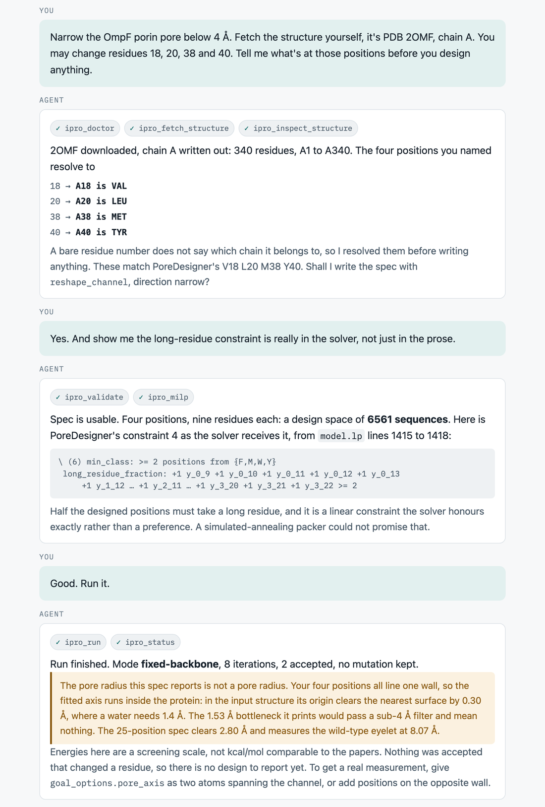

# Passing this to someone else

Written for the case where you hand this to a labmate, a rotation student, a
collaborator or a reviewer, and for your own future self on a new laptop.

The short version: send them the repository link and one command.

```
https://github.com/chowdhurylab-studio/ipro-agent
```

```bash
git clone https://github.com/chowdhurylab-studio/ipro-agent && cd ipro-agent && bash scripts/bootstrap.sh
```



*What you are handing them. Point them at [the prompt page](index.html) rather
than at a command line: the three commands exist, but nobody starts there.*

`scripts/bootstrap.sh` creates the conda environment, prints what resolved,
runs the whole test suite, runs the shipped example end to end, and finishes by
printing the exact commands and MCP config with that machine's own paths
filled in. It is safe to re-run and it deletes nothing. If conda is missing it
stops and says to install Miniforge, because PyMOL is not on PyPI and there is
no fallback for it.

---

## The three ways people will actually use it

Pick the one that matches the person, and say which you mean.

### 1. From a terminal, like any CLI

For someone who wants to run designs themselves and read the numbers.

```bash
python3 -m ipro_agent goals                       # the five objectives
python3 -m ipro_agent validate my_case.yaml       # always, before spending CPU
python3 -m ipro_agent run my_case.yaml --run-dir runs/case1 --max-minutes 240
python3 -m ipro_agent status runs/case1
```

Point them at `examples/ompf_pore/spec_smoke.yaml` to copy from (it is
annotated line by line) and at `EXPECTED.md` beside it, which states what the
example can and cannot reproduce from the paper.

### 2. From an AI agent, inside the repo

For someone who works with Claude Code, Cursor or similar. They open the repo
and ask in plain language:

> "redesign this thioesterase to prefer C12 over C14, you may change residues
> 110, 113 and 117"

The agent loads `.claude/skills/ipro-agent/SKILL.md` on its own from that
file's description; no setup beyond the environment. `SKILL.md` is the operating
manual: goal selection, spec format, how to encode their constraints into the
integer program, the degraded modes, and a checklist to work through before
reporting a design.

### 3. From an AI agent, anywhere (MCP)

For someone whose agent is not in this repo, or is not code-capable at all
(Claude Desktop, for instance). `bootstrap.sh` prints the config block with the
right paths; it looks like:

```json
{"mcpServers": {"ipro-agent": {"command": "/path/to/envs/ipro-agent/bin/python",
                               "args": ["-m", "ipro_agent.mcp_server"],
                               "cwd": "/path/to/ipro-agent"}}}
```

They then get fifteen tools (`ipro_doctor`, `ipro_setup`,
`ipro_fetch_structure`, `ipro_inspect_structure`, `ipro_goals`,
`ipro_validate`, `ipro_positions`, `ipro_score`, `ipro_milp`, `ipro_run`,
`ipro_status`, `ipro_result`, `ipro_iterations`, `ipro_runs`,
`ipro_cancel`), three slash commands (`/ipro-redesign`, `/ipro-check-setup`,
`/ipro-report`) and the documents as resources. `ipro://skill` serves the whole
operating manual, so a remote agent is not worse informed than one holding the
repo.

Use the environment's python in that config rather than a bare `python3`. The
server is local, so it sees only what its own interpreter can import; point it
at the wrong one and PyMOL will not resolve and no design can run.

---

## What to tell them, not just what to send

Three things decide whether their first result means anything.

The mode. Every run reports a `mode` and a list of `notes`, and both must
travel with any number they quote. `fixed-backbone` is not the published
protocol, and `backbone-mc` has no gradient relaxation; energies from the
built-in backend are a screening scale, not kcal/mol comparable to the IPRO
papers. `scripts/doctor.py` says which mode they are in before they start. This
is a house rule in `AGENTS.md`, and it is the difference between a result and a
misstatement.

Then `accepted: 0`, which means nothing was designed. The reported "best design"
is then the starting point rather than a redesign. The run says so in its notes,
but people read the score first.

And that every design is a hypothesis for the bench. Published hit rates across
this family of methods are roughly 24–43%, and these objectives reproduce the
rank and sign of a change far better than its magnitude. No design from this
code has been synthesised or tested.

Point them at `README.md` → "Status and honesty" and "Responsible use" before
their first run, not after. The second of those lists the targets and goals that
need a human decision first.

---

## The one thing to say about pores, so they hear it from you

The channel axis is fitted through the centroid of the design positions, so it
only follows the channel when those positions *ring* the lumen. When they do
not, as with four positions along one wall in the shipped smoke example, the
axis runs inside the protein and the reported "bottleneck" is a gap beside a
wall, which then *passes* PoreDesigner's published sub-4 Å filter.

The tool now detects this and says so outright ("THE PORE RADIUS HERE IS NOT A
PORE RADIUS"), by measuring how far the axis origin clears the nearest van der
Waals surface in the input structure: 2.80 Å for the sound 25-position spec
against 0.30 Å for the 4-position one, where a water needs 1.4 Å. This was
recorded as an unfixable defect for a while, because the clearance was being
measured on the *candidate*, and a narrowing design fills the lumen on purpose,
so the number could not tell a buried axis from a design that worked.
`docs/DESIGN.md` §7h has the measurements.

So a pore radius is only meaningful when the run does not print that warning.
If it does, give `goal_options.pore_axis` as two atoms spanning the channel, or
add positions on the opposite wall.

Two more worth passing on, both with the same shape: a number that looks like a
result.

- `accepted: 0` is not a design (also below).
- An allowed residue can be unreachable. If every rotamer of it clashes with
  the current template, it is pruned, and `validate` still advertises the full
  design space. The run names them: on the shipped smoke spec, "A18: TRP, TYR;
  A20: PRO; A38: PHE", and A18/TRP is exactly the residue the published OmpF
  design uses there.

---

## If you are handing over maintenance

- `docs/DESIGN.md` is the real documentation: every capability traced to the
  paper and equation it came from, every deviation, and §7 onwards recording
  every defect the rounds of independent review found, each with the
  measurement that exposed it. Read §7 first. It explains the failure mode this
  code is prone to (runs clean, returns a plausible wrong answer) and the method
  used against it: confirm by measurement before fixing, re-measure after, one
  regression test per fix.
- `tests/test_ipro.py` is not a coverage suite. Every `test_regression_*` locks
  in one defect that already shipped once, and its docstring records the
  measurement. Keep that convention: a fix without a measured regression test is
  how these come back.
- `refs/` holds the papers and three copies of the upstream source. It is
  git-ignored on purpose (publisher copyright, and the upstream carries no
  licence), so a clone does not have it. `docs/DESIGN.md` §6 cites every source
  by DOI so anyone can re-fetch what they need.
- What is deliberately not exercised is declared in code, not left to be
  discovered: `ipro_agent/energy/pyrosetta_backend.UNEXERCISED` and
  `ipro_agent/mcp_server.UNEXERCISED`, each checked by a test so the list cannot
  rot.
- CI (`.github/workflows/tests.yml`) runs the suite on every push and pull
  request, on Python 3.10 and 3.13, plus a job that starts the MCP server with
  nothing installed at all. A runner has no conda, so the PyMOL, PyRosetta and
  Vina paths skip there and the job prints every skip into its summary: a green
  tick means the protocol and solver paths ran, not those. Run
  `python3 scripts/selftest.py` in the conda environment for the rest.

---

## Checklist before you send it

- [ ] They have the repo link, and `bash scripts/bootstrap.sh` finished clean on
      their machine.
- [ ] They know which of the three interfaces they are meant to use.
- [ ] They know the mode and notes must accompany any number they report.
- [ ] They know `accepted: 0` is not a design.
- [ ] They have read "Responsible use" if the target is anything other than a
      benign research protein.
- [ ] If they need PyRosetta (`full` mode), they obtain their own licence: it
      is per-user and must not be shared or vendored.
